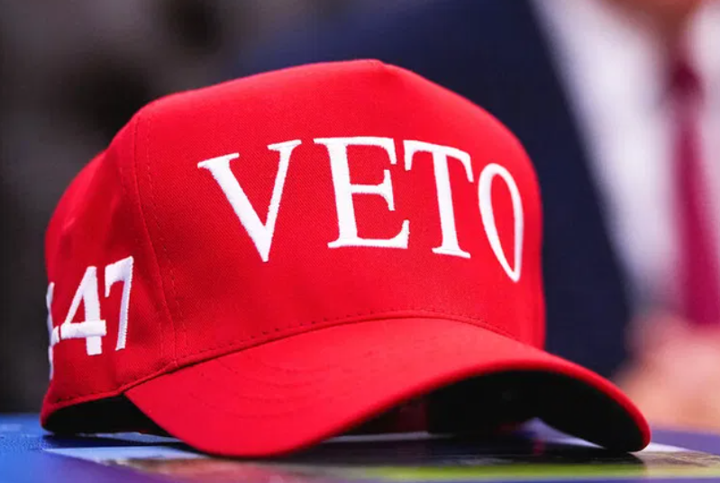

Will the Democrats go on an Impeachment rampage, and risk being viewed as vindictive and not focussing on the issues that matter to people? Maybe not, but surely they'll impeach a few, Hegseth for one. I've already got the popcorn ready.

Some Democrats are willing to cooperate with Trump to get stuff done, such as ending wars, changing immigration policy, improving medical services etc, and if that involves appealing to his ego so be it. Rather that than wait until 2029 to change presidents, and have Trump veto every proposal until then.

Senator James Talarico said “If President Trump wants the same plaques and portraits and busts as LBJ, we can help make that a reality... We should make the final two years of his presidency the most productive of any presidency in American history".

Senator Abdul El-Sayed stated “If he wants to pass Trump care for all, which will guarantee health care to everyone and put his name on it like he's putting his name on everything, I'm game".

Should be interesting and lets hope progress doesn't get completely bogged down by partisan political shenanigans (hoping same for UK).